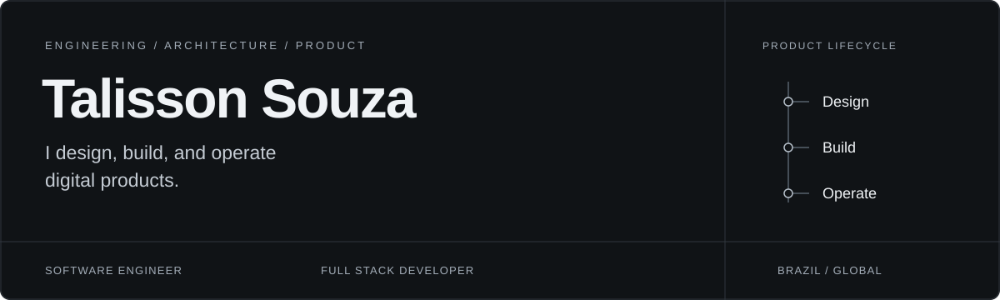
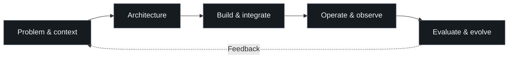

<strong>Software Engineer · Full Stack Developer · Entrepreneur</strong> Brazil · Engineering with product intent

<a href="https://www.talissonsouza.com.br">Website</a> &nbsp; / &nbsp; <a href="https://www.linkedin.com/in/talinho">LinkedIn</a> &nbsp; / &nbsp; <a href="mailto:contato@talissonsouza.com.br">Email</a>

 

I build software around real problems: full-stack applications, backend services, integrations, and automation. Architecture, product decisions, and the realities of operating a system belong in the same conversation.

## 01 / Languages & tools

**Languages**

Java · Python · JavaScript · TypeScript

| Backend & integration | Interfaces & product | Data & delivery |
| :--- | :--- | :--- |
|  |  |  |
| Spring Boot · Python | React · Vite | PostgreSQL · SQL Server · Supabase |
| REST APIs · integrations | JavaScript · TypeScript | Docker · Git · GitHub · cloud infrastructure |

Tools I work with, organized by responsibility. Architecture follows the problem.

 

## 02 / From problem to operation

An engineering approach guided by product context, clear boundaries, and maintainability.

| Design with context | Build with clarity | Operate with responsibility |
| :--- | :--- | :--- |
| Understand constraints, cost, and expected impact. Choose architecture for the actual problem. | Keep responsibilities explicit, interfaces readable, and delivery scope focused. | Treat security, performance, and observability as design requirements. |

 

## 03 / Selected open source

### [AI Audit Framework](https://github.com/TalissonDeevv/application-audit-framework)

**Structured methodology for AI-assisted software audits.**

Specialized audit domains cover architecture, security, code quality, performance, and infrastructure. Shared evidence requirements, severity and confidence models, and finding formats give the analysis a consistent structure.

| Foundation | Current scope |
| :--- | :--- |
| Evidence requirements · domain separation · structured reporting | Documentation · prompts · schemas · specifications |

[Explore repository](https://github.com/TalissonDeevv/application-audit-framework) &nbsp; / &nbsp; [Evidence rules](https://github.com/TalissonDeevv/application-audit-framework/blob/main/core/evidence.md) &nbsp; / &nbsp; [Finding schema](https://github.com/TalissonDeevv/application-audit-framework/blob/main/schemas/finding-schema.md)

The current repository provides the methodology and reference materials; an executable audit engine is outside its implemented scope.

 

## 04 / Product & collaboration

A useful solution starts with a real problem and continues through architecture, user experience, delivery, and operation. I bring engineering and entrepreneurial judgment to those decisions, with attention to cost, security, and long-term usefulness.

My public professional context includes [Cheetah Solutions Network](https://github.com/CheetahSolutions), focused on software engineering and operational automation.

**For product development, engineering collaboration, and business conversations.**

[Website](https://www.talissonsouza.com.br) · [LinkedIn](https://www.linkedin.com/in/talinho) · [Email](mailto:contato@talissonsouza.com.br) · [WhatsApp](https://wa.me/5581993964261)

[Instagram](https://instagram.com/talissondev) · [YouTube](https://www.youtube.com/TalissonSouza) · [Discord community](https://discord.com/invite/WXwguHWjxg)
