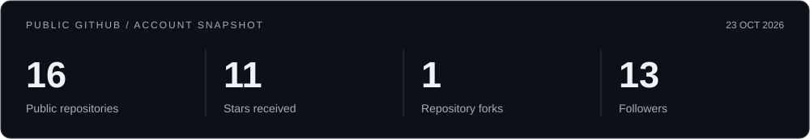
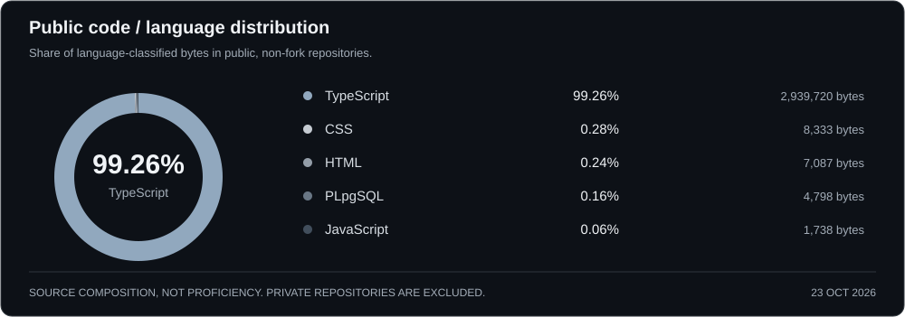
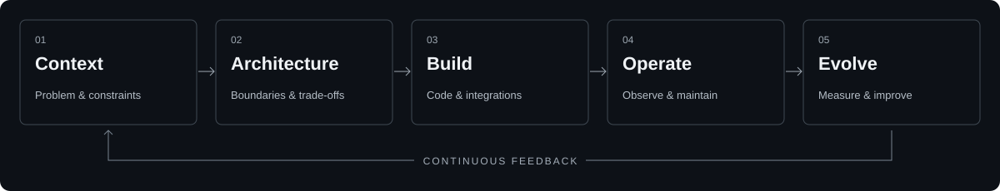
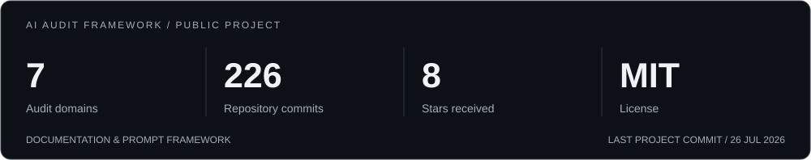
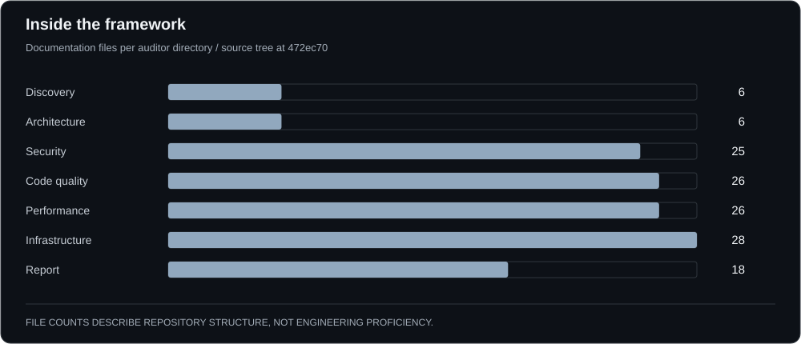

<strong>Software Engineer · Full Stack Developer · Entrepreneur</strong> Brazil · Engineering with product intent

<a href="https://www.talissonsouza.com.br">Website</a> &nbsp; / &nbsp; <a href="https://www.linkedin.com/in/talinho">LinkedIn</a> &nbsp; / &nbsp; <a href="mailto:contato@talissonsouza.com.br">Email</a>

Full-stack software, backend services, integrations, and automation. I connect engineering decisions to product needs, operating costs, and long-term maintainability.

## 01 / Public GitHub snapshot

October 23, 2026 · [Public API data](assets/public-stats.json). Source-byte percentages describe public code, not proficiency. Private repositories are excluded; this is a dated snapshot.

## 02 / Languages & tools

Java · Python · JavaScript · TypeScript

| Backend & integration | Interfaces | Data & delivery |
| :--- | :--- | :--- |
| Spring Boot · Python · REST APIs | React · Vite · TypeScript | PostgreSQL · SQL Server · Supabase |
| Services · integrations · automation | Product interfaces | Docker · Git · cloud infrastructure |

## 03 / How I build

| Context | Clarity | Operation |
| :--- | :--- | :--- |
| Architecture follows the problem, constraints, and cost of ownership. | Explicit contracts, modular responsibilities, and readable code. | Security, performance, and observability from the design stage. |

**Automation & applied AI:** repeatable workflows, explicit failure handling, evidence-based analysis, and human review where judgment matters.

## 04 / Selected open source

### [AI Audit Framework](https://github.com/TalissonDeevv/application-audit-framework)

A structured methodology for AI-assisted software audits, with domain-specific prompts, evidence rules, and shared finding formats.

[Repository](https://github.com/TalissonDeevv/application-audit-framework) · [Evidence rules](https://github.com/TalissonDeevv/application-audit-framework/blob/main/core/evidence.md) · [Finding schema](https://github.com/TalissonDeevv/application-audit-framework/blob/main/schemas/finding-schema.md) · [Chart data](assets/aaf-public-data.json)

Current scope: documentation, prompts, schemas, and specifications. File and commit counts describe the repository; they do not imply an executable audit engine or completed automated tests.

## 05 / Product & collaboration

Engineering decisions should account for the problem, user experience, security, maintenance, and business impact. My public professional context includes [Cheetah Solutions Network](https://github.com/CheetahSolutions).

**Product development · Technical architecture · Automation · Open source**

Share the problem, the constraints, and the outcome that matters.

[Website](https://www.talissonsouza.com.br) · [LinkedIn](https://www.linkedin.com/in/talinho) · [Email](mailto:contato@talissonsouza.com.br) · [WhatsApp](https://wa.me/5581993964261)

[Instagram](https://instagram.com/talissondev) · [YouTube](https://www.youtube.com/TalissonSouza) · [Discord community](https://discord.com/invite/WXwguHWjxg)
