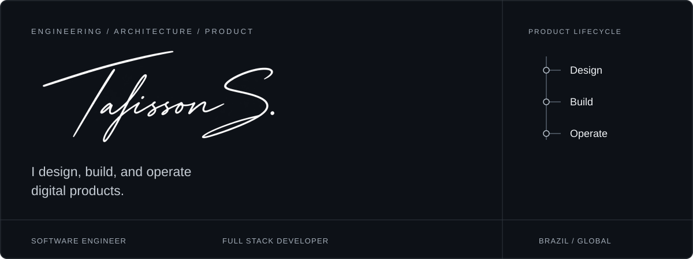
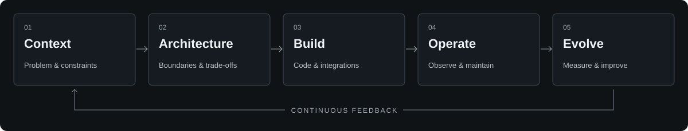

<strong>Software Engineer · Full Stack Developer · Entrepreneur</strong> Brazil · Engineering with product intent

<a href="https://www.talissonsouza.com.br">Website</a> &nbsp; / &nbsp; <a href="https://www.linkedin.com/in/talinho">LinkedIn</a> &nbsp; / &nbsp; <a href="mailto:contato@talissonsouza.com.br">Email</a>

 

I build software around real problems: full-stack applications, backend services, integrations, and automation. Architecture, product decisions, and the realities of operating a system belong in the same conversation.

## 01 / Languages & tools

**Languages**

Java · Python · JavaScript · TypeScript

| Backend & integration | Interfaces & product | Data & delivery |
| :--- | :--- | :--- |
|  |  |  |
| Spring Boot · Python | React · Vite | PostgreSQL · SQL Server · Supabase |
| REST APIs · integrations | JavaScript · TypeScript | Docker · Git · GitHub · cloud infrastructure |

Tools I work with, organized by responsibility. Architecture follows the problem.

 

## 02 / From problem to operation

An engineering approach guided by product context, clear boundaries, and maintainability.

| Design with context | Build with clarity | Operate with responsibility |
| :--- | :--- | :--- |
| Understand constraints, cost, and expected impact. Choose architecture for the actual problem. | Keep responsibilities explicit, interfaces readable, and delivery scope focused. | Treat security, performance, and observability as design requirements. |

 

## 03 / Architecture in practice

I choose architecture by looking at the problem, the people who will maintain the system, and the cost of operating it. A modular application, a set of services, or an event-driven flow should earn its complexity through a concrete requirement.

| Layer | Questions that guide the design |
| :--- | :--- |
| **Experience & interfaces** | What does the user need to accomplish? Are states, errors, and boundaries clear? |
| **Services & APIs** | Where do business rules belong? Are contracts explicit and failures predictable? |
| **Data & access** | Who owns the data? What must stay consistent? How is access authorized? |
| **Infrastructure & operation** | How is the system deployed, observed, recovered, and maintained? |

**Boundaries before distribution.** Separate responsibilities where they improve clarity. Introduce additional services when the product and operational context justify them.

**Contracts before assumptions.** Make inputs, outputs, validation, and error behavior explicit. Integrations need to account for timeouts, retries, and duplicate work where those conditions apply.

**Evolution without guesswork.** Keep important decisions understandable through focused documentation, migration discipline, and changes that can be reviewed and recovered.

 

## 04 / Engineering standards

### Security by design

Authentication and authorization are separate responsibilities. Access checks should follow the resource and action involved, while sensitive configuration stays outside source code. Data exposure, dependency risk, and infrastructure permissions belong in the design discussion.

### Performance as a requirement

Start with the workload and the user experience. Query behavior, network boundaries, payload size, and expensive operations can shape architecture early. Measure bottlenecks before adding caches, concurrency, or operational complexity.

### Observability with a purpose

A system should help explain its own behavior. Useful logs, meaningful metrics, and actionable failure signals should answer practical questions: what failed, where it failed, who was affected, and what needs attention.

### Maintainability as a delivery constraint

Readable code, clear ownership, and focused tests make future changes safer. I value verification around business behavior, access boundaries, data changes, and failure paths. Delivery speed should include the cost of understanding and maintaining what was shipped.

 

## 05 / Automation & applied AI

Automation is most useful when it removes a repeated operational burden and leaves a workflow that can still be understood and controlled.

- **Workflows & integrations:** connect systems through explicit contracts, with clear failure handling and recovery paths.
- **Bots & internal tools:** give repetitive processes a usable interface and a consistent execution model.
- **Applied AI:** use models where they help with analysis or execution, while keeping evidence, validation, and human responsibility visible.

For AI-assisted engineering, generated output is a starting point for review. Claims need evidence, changes need context, and the final result must remain understandable to the people responsible for the system.

 

## 06 / Selected open source

### [AI Audit Framework](https://github.com/TalissonDeevv/application-audit-framework)

**Structured methodology for AI-assisted software audits.**

Specialized audit domains cover architecture, security, code quality, performance, and infrastructure. Shared evidence requirements, severity and confidence models, and finding formats give the analysis a consistent structure.

| Foundation | Current scope |
| :--- | :--- |
| Evidence requirements · domain separation · structured reporting | Documentation · prompts · schemas · specifications |

[Explore repository](https://github.com/TalissonDeevv/application-audit-framework) &nbsp; / &nbsp; [Evidence rules](https://github.com/TalissonDeevv/application-audit-framework/blob/main/core/evidence.md) &nbsp; / &nbsp; [Finding schema](https://github.com/TalissonDeevv/application-audit-framework/blob/main/schemas/finding-schema.md)

The current repository provides the methodology and reference materials; an executable audit engine is outside its implemented scope.

 

## 07 / Product & collaboration

A useful solution starts with a real problem and continues through architecture, user experience, delivery, and operation. I bring engineering and entrepreneurial judgment to those decisions, with attention to cost, security, and long-term usefulness.

My public professional context includes [Cheetah Solutions Network](https://github.com/CheetahSolutions), focused on software engineering and operational automation.

I am interested in conversations where engineering can change how a product or an operation works: a clearer system boundary, a useful integration, a more reliable workflow, or a digital product with a well-defined purpose.

**Product development · Technical architecture · Automation · Open-source collaboration**

### Start a conversation

Share the problem, the current constraints, and the outcome that matters. That is a useful place to start a product or engineering discussion.

[Website](https://www.talissonsouza.com.br) · [LinkedIn](https://www.linkedin.com/in/talinho) · [Email](mailto:contato@talissonsouza.com.br) · [WhatsApp](https://wa.me/5581993964261)

[Instagram](https://instagram.com/talissondev) · [YouTube](https://www.youtube.com/TalissonSouza) · [Discord community](https://discord.com/invite/WXwguHWjxg)
